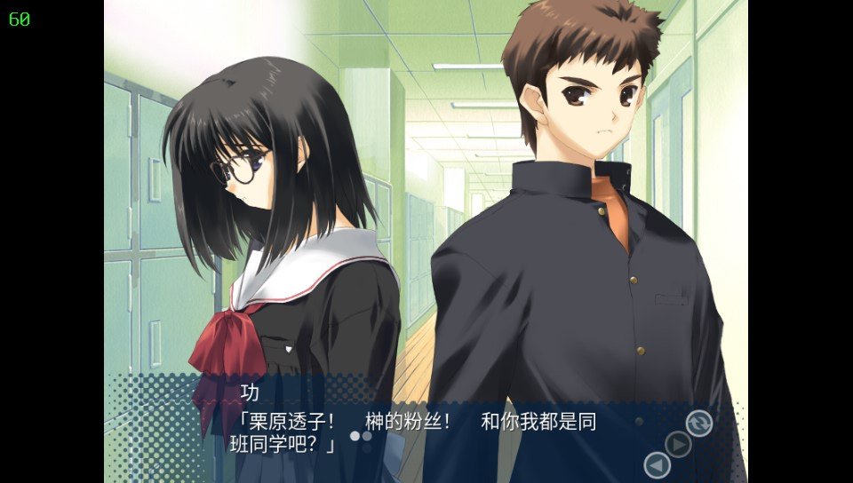
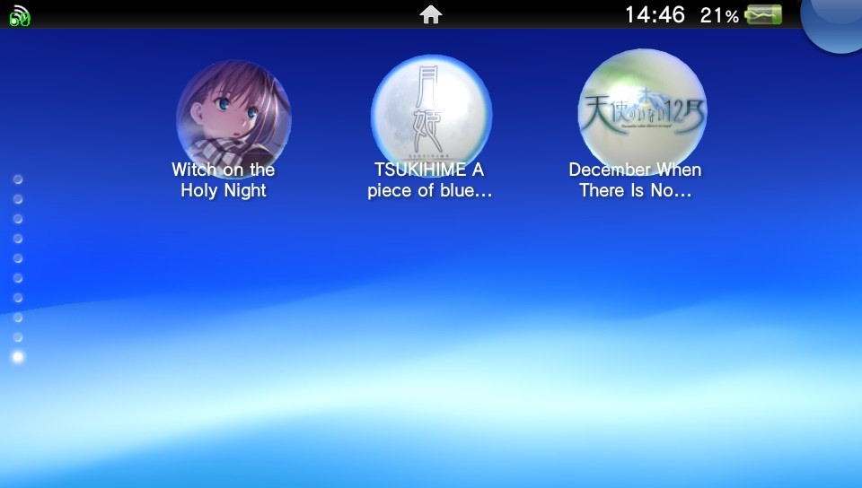
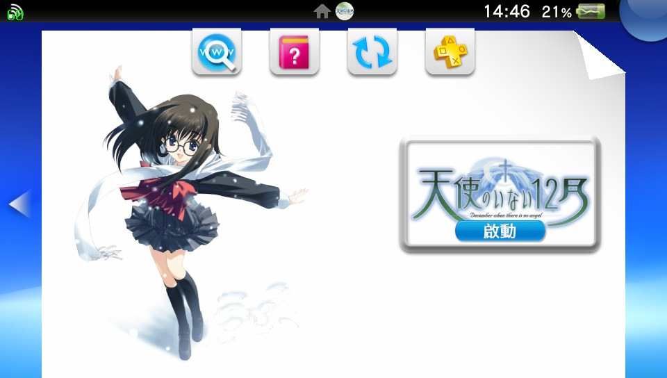
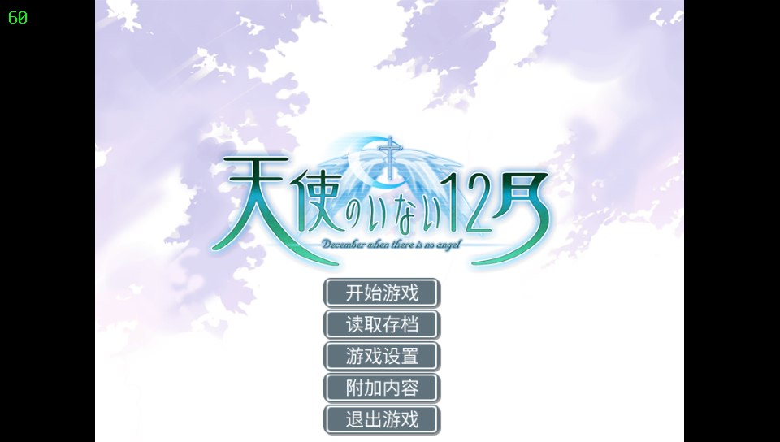
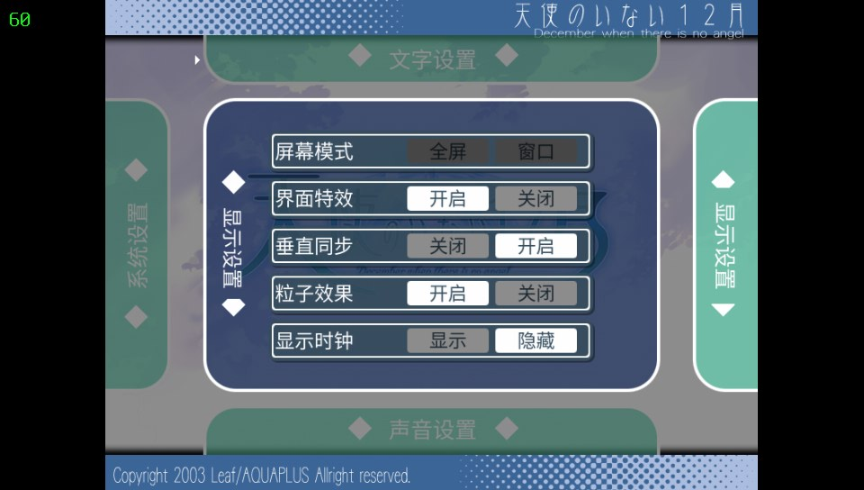

# 天使不在的十二月 · PS Vita

**December When There Is No Angel**

[](https://github.com/ATSPwang618/TenshinoInai12gatsu-psv/actions/workflows/vita.yml)

在 PS Vita 上游玩《天使不在的十二月》：中文剧情与菜单、按键和触摸操作，以及适合掌机的存读档界面。

**本项目建立在 [dorakyuraduang/TenshinoInai12gatsu-psv](https://github.com/dorakyuraduang/TenshinoInai12gatsu-psv) 的基础上，沿用上游 PSV 移植代码继续开发，并非从零独立实现。感谢原作者 dorakyuraduang 及上游贡献者的工作。** 本仓库在此基础上继续完善中文界面、界面与人物动画、LiveArea 资源和自动构建流程，保留上游版权与许可声明。

> 本仓库分发移植程序及其源码，不提供原作游戏数据。游玩需要自行准备合法持有、且与本移植兼容的 PC 版资源。

## 版本特色

- **中文游玩界面**：中文菜单、设置与存读档界面，内置思源黑体中文字体。
- **掌机操作**：支持实体按键、前触摸屏、对白历史、自动播放与已读快进。
- **手动存读档**：40 个槽位，分为 5 页；显示存档信息与缩略图，覆盖前询问确认。
- **界面与人物演出**：菜单及页面切换动画、存读档灰色遮罩，以及剧情人物进退场、换位和表情切换过渡；动画由 VPK 引擎处理，无需改写游戏归档。
- **完整气泡资源打包**：包含自定义图标、启动图、LiveArea 与说明书；应用显示名称为 `December When There Is No Angel`。
- **程序与资源分离**：VPK 不包含商业游戏归档或片头视频；资源在外置数据目录中读取，升级程序时不必重新复制整套数据。
- **自动化构建**：本地资源整理与 WSL VitaSDK 构建串联；GitHub Actions 可独立测试、构建并校验纯程序 VPK。

## 实机截图

以下为用户提供的 PS Vita 实机静态截图，展示气泡、LiveArea 和中文界面。静态截图不代表最新动画已完成实机验收，也不能据此判断持续帧率。

### 剧情画面



中文对白、人物立绘与剧情操作区域。原作采用 4:3 画面，PS Vita 屏幕两侧的黑边属于正常显示布局。

| 气泡与应用名称 | LiveArea 启动页 |
| --- | --- |
|  |  |
| 主界面中的自定义游戏气泡。 | 启动页背景、游戏标识与启动入口。 |

| 标题菜单 | 系统设置 |
| --- | --- |
|  |  |
| 中文标题菜单与游戏入口。 | 中文设置选项及覆盖在游戏画面上的设置面板。 |

截图中的游戏画面及美术素材版权归原权利人所有，不适用本项目的 MIT 许可。

## 下载与安装

### 获取本仓库构建

打开 [GitHub Actions 构建页面](https://github.com/ATSPwang618/TenshinoInai12gatsu-psv/actions/workflows/vita.yml)，选择 `main` 上最近一次**成功**的构建，在页面底部的 Artifacts 中下载 `tenshi-vita-<提交 SHA>`，解压后取得 `tenshi-vita.vpk`。不要将带有 `logs` 的诊断包当作安装包。

构建产物包含纯程序 VPK、源码包、构建报告和 SHA-256 校验文件，**不包含原作游戏数据**。本地完整构建的交付目录固定为 `realease/`，安装包为 `realease/tenshi-vita.vpk`；`realease` 是项目沿用的目录名。

### 安装到 PS Vita

1. 在能够安装自制软件的 PS Vita 上，用 VitaShell 安装 `tenshi-vita.vpk`。应用 ID 为 `TNSH00001`。
2. 准备本移植支持的 GB18030 资源版，将下列文件直接放入 `ux0:/data/tenshi/`。不要解包 `.a` 归档，也不要多套一层 `data` 或游戏名称目录。
3. 启动气泡进入游戏。已有存档的玩家升级前请先备份整个 `ux0:/data/tenshi/`，不要为更新 VPK 删除该目录。

```text
ux0:/data/tenshi/
├── tenshi_dvd.a
├── sys.a
├── egbg.a
├── char.a
├── voice.a
├── music.a
├── se.a
├── ed.a
├── opening.mp4
└── opening.idx
```

如果已经通过本地资源流水线生成数据包，将 `realease/data/` **里面的文件**复制到上述目录即可。随包的 `opening.json` 是转换与哈希记录，可以一并保留，但不参与运行时播放。

`opening.mp4` 和 `opening.idx` 必须来自同一次转换，不能直接用原始 `openning.v` 替代。并非任意 PC 版或汉化版都可直接混用；更换游戏归档也可能导致旧存档因资源指纹不同而无法读取。

首次序章完成后，后续启动仍会经过 Logo 与片头；这不代表存档丢失，片头可以跳过。Vita3K 数据目录、资源要求及黑屏日志排查，见 [完整安装与排错说明](INSTALL.md)。

## 操作与存档

| 操作 | 功能 |
| --- | --- |
| × | 确认；对白逐字显示时先补全当前页，再次按下推进 |
| ○ | 返回；剧情中隐藏或恢复对白；跳过片头 |
| 方向键 | 菜单与选项导航、历史翻页、调整设置滑条 |
| △ | 打开对白历史，可通过界面重播语音 |
| START | 打开设置与存读档入口；在界面中返回 |
| L | 自动推进开关 |
| R | 快进开关，默认仅对已读对白生效 |
| 前触摸屏 | 点击按钮与选项，拖动滑条 |

本版使用**手动剧情存档**，不会在重启时自动恢复到退出前的对白。

- 保存：剧情中按 `START → 存读档页 → 保存 → 选择槽位`。
- 读取：标题菜单进入读取存档，或在剧情中的存读档页选择“读取”。
- 升级：备份资源目录中的存档、设置与已读记录，再安装新 VPK；保留原数据目录。

设置、已读记录和鉴赏解锁的持久化不能替代剧情存档。更详细的槽位、备份文件与兼容性说明见 [安装说明中的保存与读取](INSTALL.md#保存读取和退出)。

## 开发与构建

### 项目结构

```text
src/                  C++ PSV 引擎与界面实现
tests/                主机回归测试与演出检查
tools/                本地构建、校验与发行工具
vita_asset_pipeline/  资源整理与自动构建流水线
assets/               字体与构建元数据，不含商业游戏归档
sce_sys/              气泡、LiveArea 与说明书
docs/screenshots/     README 使用的实机截图
.github/workflows/    GitHub Actions 构建配置
realease/             本地交付目录，不纳入 Git
```

运行时采用 C++17、SDL2 与 VitaSDK；Vita 渲染使用原生 GXM SDL2。商业游戏资源独立于程序，**构建纯程序 VPK 不要求持有或上传游戏数据**。

### Windows + WSL 本地完整构建

准备 Python、FFmpeg/ffprobe，以及 WSL 中已有的 VitaSDK。以下命令中的资源路径、WSL 发行版名称和 SDK 路径应按自己的环境替换：

```powershell
python tools/build-vita.py --source "D:/Games/Tenshi-PC" --wsl pocket-ubuntu --sdk /opt/vitasdk
```

流水线整理资源、转换片头、处理中文菜单并构建校验 VPK，结果放入 `realease/`，游戏数据位于 `realease/data/`。缓存与构建日志集中在 `.work/`，不需要手动将临时文件放进源码目录。

### 不含游戏资源的程序构建

在已配置依赖的 Linux / VitaSDK 环境中执行：

```sh
python3 -m unittest discover -s tests -p '*_test.py' -v
python3 tools/build-ci.py --sdk /opt/vitasdk --output dist/ci-local
```

输出目录必须是新目录或空目录，工具不会覆盖已有 CI 产物。GitHub Actions 使用同一程序构建入口，上传 VPK、包含 README 截图的源码包及校验文件，不读取本地 `realease/data/`。

关于依赖、构建细节和设备验证，请参阅：

- [移植与构建说明](PORTING.md)
- [验证记录与设备测试边界](VALIDATION.md)
- [与 Godot 版的差异审计](GODOT_PARITY_AUDIT.md)
- [第三方组件与字体许可](THIRD_PARTY_NOTICES.md)

Godot 参考生成属于可选的开发验证步骤，不是安装或构建 PSV 程序的前提；需要时应按移植说明单独准备相应的 Godot 参考项目。

## 当前验证边界与问题反馈

主机验证覆盖界面布局、输入、存读档及人物与界面动画的定向行为，但不等于完整实机通关或性能验收。

目前仍有部分原版专用转场滤镜未还原，字体栅格化及雪花随机序列也存在差异；完整片头音画同步、休眠恢复、全部路线与新增动画的设备表现仍需要进一步实机验证。不要仅凭构建成功或截图中的计数器判断兼容性与稳定帧率。

遇到黑屏、异常退出或资源读取问题，可在 [Issues](https://github.com/ATSPwang618/TenshinoInai12gatsu-psv/issues) 中提供：

- 构建提交或版本，以及 PS Vita / Vita3K 环境。
- 重现步骤、发生位置和相关设置。
- `ux0:/data/tenshi/runtime.log` 中的相关文字日志。

请勿上传完整商业游戏归档；日志和截图提交前也请自行检查隐私信息。

## 开发与致谢

### 上游项目

本项目以 **[dorakyuraduang/TenshinoInai12gatsu-psv](https://github.com/dorakyuraduang/TenshinoInai12gatsu-psv)** 为开发基础。感谢 **dorakyuraduang 及上游贡献者**提供原有的 PSV 移植实现、源码与相关文档，使本仓库后续的中文界面、演出优化、资源流水线和自动构建工作得以继续开展。

本仓库的后续修改不改变上游来源与原有贡献的归属。上游 MIT 版权声明继续保留在 [LICENSE](LICENSE) 中，第三方许可及对应来源资料保留在 `licenses/`、`third_party/` 和发行源码包中。

### 其他致谢与许可

- 感谢原作开发者与相关权利人，以及汉化资源的贡献者。原作剧本、美术、声音、视频及相关汉化资源的权利归各自权利人所有；它们不因本移植而变为开源素材。
- 感谢 VitaSDK、SDL2 及本项目使用的其他开源组件与 PS Vita 自制软件社区。具体组件及许可证以 [第三方声明](THIRD_PARTY_NOTICES.md) 为准。
- 感谢 Adobe 思源黑体项目。内置的思源黑体简体常规字重按 SIL OFL 1.1 分发，见 [字体许可说明](FONT_LICENSE.md)。
- 感谢提供气泡美化资源、实机截图、测试与问题反馈的贡献者。

移植程序代码遵循仓库的 [MIT 许可](LICENSE)，第三方代码及字体按各自许可证使用。**MIT 许可不涵盖原作游戏数据、截图内的游戏画面及其他权利人素材。**
